  

# 🏭 Awesome Manufacturing Execution & Production Planning ⚙️

  
  
  
  
  

> 🌟 A curated list of top **Manufacturing Execution Systems (MES)**, **Production Planning & Scheduling (APS)** platforms, and **Material Requirements Planning (MRP)** solutions — comparing enterprise SaaS platforms with open-source alternatives for work order scheduling, shop floor execution, OEE tracking, and production inventory. 🚀

---

## 📑 Table of Contents 📌

- [🌐 Sector Overview & Market Dynamics](#-sector-overview--market-dynamics-)
- [🟦 SaaS / Commercial Platforms](#-saas--commercial-platforms-)
- [🟩 Open-Source Software](#-open-source-software-)
- [📊 Feature Comparison Matrix](#-feature-comparison-matrix-)
- [🤝 Contributing](#-contributing-)
- [💖 Support](#-support-)
- [📈 Star History](#-star-history-)
- [📄 License](#-license-)

---

## 🌐 Sector Overview & Market Dynamics 📈

The global **Manufacturing Execution Systems (MES)** and Production Planning market is valued at approximately **$14B–$18.6B** and is projected to expand to **$32B–$56B** by the early 2030s at an estimated compound annual growth rate (CAGR) of **11%–15%**, driven by Industry 4.0 automation, IIoT adoption, and supply-chain agility demands. 🏭💡

The sector is **moderately to highly fragmented**, characterized by a multi-tier competitive structure rather than a winner-take-all outcome: massive industrial automation and enterprise software conglomerates (Siemens, SAP, Rockwell Automation, Dassault Systèmes) anchor complex, multi-site discrete and process deployments, while agile, cloud-native SaaS disruptors (Katana, MRPeasy) and emerging open-source/agent-native frameworks capture SMBs and developer-first modular shop floors. 🔄

---

## 🟦 SaaS / Commercial Platforms 🏢

The table below ranks commercial, cloud-hosted Manufacturing Execution and Production Planning platforms by company scale (annual revenue / valuation, descending). 🏆

| Product | Vendor / Parent | Company Size (Rev / Valuation) | Pricing (Specific Starting Tiers) | Free Tier / Free Trial Limits | Key Capabilities |
|---|---|---|---|---|---|
| **Siemens Opcenter** | Siemens AG | **€83.4B (~$89B) ARR** (Parent) | Starting at **$35,000/year** (~$2,917/mo, AWS marketplace baseline 10-user pack) or APS Standard module direct purchase | **No free tier**; **30-day free trial** for cloud-based modules (Opcenter APS Scheduling Standard & Opcenter Intelligence Cloud) with full sandbox features | Enterprise discrete & process MOM/MES, closed-loop finite capacity scheduling, digital twin plant simulation, ISO 22400 KPIs 🏭 |
| **SAP Digital Manufacturing** | SAP SE | **€36.8B (~$42.4B) ARR** (Parent) | Custom enterprise quote; baseline third-party estimated entry tiers start around **$105/user/month** (BTP consumption fees apply) | **No free tier**; **No self-service free trial** (Guided virtual interactive product tour & custom sales-assisted PoC available) | Cloud MOM built on SAP BTP, ISA-95/S88 data models, native SAP S/4HANA & SuccessFactors orchestration, AI production dispatching ☁️ |
| **Plex Systems** | Rockwell Automation | **$8.34B ARR** (Parent) | Entry platform subscriptions start at **$3,000/month** (or ~$120–$500/user/month depending on modules deployed) | **No free tier**; **No self-service free trial** (24/7 dedicated customer testing sandbox included post-contract; guided live demo on request) | Cloud-native smart manufacturing platform, finite scheduling engine, closed-loop QMS, machine telemetry, unlimited user model ⚡ |
| **DELMIA Apriso** | Dassault Systèmes | **€6.39B (~$7.05B) ARR** (Parent) | Enterprise quote; entry-level sister product *DELMIAWorks* starts at **$250/user/month** (Apriso multi-site deployments are custom yearly license charges) | **No free tier**; **No self-service free trial** (Assisted vendor proof of concept / guided virtual walk-throughs available upon qualification) | Global multi-site MOM, low-code Business Process Management (BPM) engine, virtual twin factory simulation, full genealogy 🌐 |
| **Katana Cloud Manufacturing** | Katana MRP | **$175M Valuation** ($10.3M ARR) | **$299/month** (billed annually for Core Standard tier; includes 3 users and shop floor operators) | **Free forever plan** limited to **up to 30 SKUs** (unlimited users, locations, and integrations); **15-day free trial** of paid tiers with unlimited SKUs (no credit card required) | SMB visual production planning, drag-and-drop Gantt scheduling, native Shop Floor App, real-time inventory & multi-channel e-commerce sync 📦 |
| **MRPeasy** | MRPeasy | **$5M ARR** (€1M–€10M bracket) | **$49/user/month** (Starter Plan, minimum 2 users = $98/month; Professional plan at $69/user/month) | **No free tier** (inactive team members for records have $0 fee but zero access); **15-day free trial** (extendable up to 30 days via onboarding milestones, up to 6 test accounts) | Finite capacity MRP II, multi-level BOM management, shop floor barcode reporting, workstation booking, inventory lot/serial tracking 📋 |

---

## 🟩 Open-Source Software 🔓

Self-hosted, community-driven Manufacturing Execution Systems, production planners, and MRP schedulers, sorted by GitHub stargazers count (descending): 🌟

| Software | GitHub_Stars | License | Technology Stack | Primary Manufacturing Focus |
|---|---|---|---|---|
| **[Carbon](https://github.com/crbnos/carbon)** |  | AGPL-3.0 | PostgreSQL, Node.js, REST API, MCP Server | Unified manufacturing ERP, MES, and QMS with quoting, MRP, shop floor dispatching, and AI agent interface 🤖 |
| **[frePPLe](https://github.com/frePPLe/frepple)** |  | AGPL-3.0 | C++, Python, Django, PostgreSQL | Advanced Planning and Scheduling (APS), finite resource capacity scheduling, demand forecasting, and ERP/Odoo integration 📊 |
| **[ricefishtech/industry4.0-mes](https://github.com/ricefishtech/industry4.0-mes)** |  | Apache-2.0 / Open Source | Java, Spring Boot, Vue.js | Open-source Industry 4.0 MES platform with work order routings, equipment integration, and production quality tracking 🏭 |
| **[metaxk-company/free-mes](https://github.com/metaxk-company/free-mes)** |  | Apache-2.0 | Java, Spring Cloud, Vue | Cloud-native distributed manufacturing execution system featuring shop floor dispatch, defect management, and inventory tracking ☁️ |
| **[smart-industry](https://github.com/jukbot/smart-industry)** |  | MIT | Python, Django, PostgreSQL | Open-source MES specifically designed for Job Shop discrete manufacturing, digital work orders, and machine assignment 🛠️ |
| **[OpenMes](https://github.com/Mes-Open/OpenMes)** |  | GPL-3.0 | PHP, Laravel, Docker, MQTT | Self-hosted MES tailored for small-to-midsize machine shops, woodworking, and assembly tracking 🪚 |
| **[osess/mes](https://github.com/osess/mes)** |  | MIT | Python, Django, JavaScript | Lightweight web-based MES covering basic production order logging, bill of materials, and workstation status 💻 |
| **[shuiping150/APS](https://github.com/shuiping150/APS)** |  | MIT | C#, .NET | Advanced Planning and Scheduling (APS) engine optimizing production scheduling and resource capacity allocation 📈 |
| **[job_shop_lib](https://github.com/Pabloo22/job_shop_lib)** |  | MIT | Python, OR-Tools | Modular framework for modeling, solving, and visualizing Job Shop Scheduling Problems (JSSP) using CP-SAT and heuristic dispatch 🧩 |
| **[python-lekin](https://github.com/hongyingyue/python-lekin)** |  | Apache-2.0 | Python | Flexible job shop scheduling and APS research library implementing heuristic, genetic algorithm, and reinforcement learning solvers 🔬 |
| **[FactorySemantics MES](https://github.com/factorysemantics/factorysemantics-mes)** |  | Apache-2.0 | Python, Frappe/ERPNext, OPC UA, MCP | Agent-native MES implementing ISA-95, PackML, and ISO 22400 standards with live OPC UA telemetry and MCP tool endpoints 🔌 |
| **[OpenI40 Platform](https://github.com/openi40/OpenI40Platform)** |  | Apache-2.0 | Java, Spring Boot | Industry 4.0 Advanced Planning & Production Scheduling engine for multi-stage constraint-based scheduling ⚙️ |
| **[OpenMRP API](https://github.com/open-mrp/api)** |  | Apache-2.0 | Go, PostgreSQL, MySQL | Programmable MRP/MES infrastructure providing agent-callable endpoints (`AgentTool: true`) and cloud-native container manifests 📡 |

---

### 🔍 Detailed Spotlights on Leading Open-Source Tools 💡

#### 1. [Carbon](https://github.com/crbnos/carbon) 🤖
- **Architecture**: A modern TypeScript/Node.js and PostgreSQL system engineered to unite ERP, MES, and QMS functionality on a single relational schema.
- **Standout Features**: Native Model Context Protocol (MCP) server support, making it directly programmable by AI agents. Handles quoting, BOM nesting, inventory lot/batch traceability, and shop floor operator terminal execution without needing disparate integration layers.

#### 2. [frePPLe](https://github.com/frePPLe/frepple) 📊
- **Architecture**: High-performance C++ scheduling calculation core wrapped with a Python/Django web UI and REST API.
- **Standout Features**: Full Advanced Planning and Scheduling (APS) capabilities that solve complex multi-resource capacity bottlenecks, demand forecasting variability, and procurement lead times. Features out-of-the-box connectors for ERPNext and Odoo.

#### 3. [FactorySemantics MES](https://github.com/factorysemantics/factorysemantics-mes) 🔌
- **Architecture**: Python-based lightweight MES built around Frappe/ERPNext, standard SQLite/PostgreSQL storage, and industrial IoT protocols.
- **Standout Features**: Full adherence to ISA-95 hierarchical data models, PackML machine states, and ISO 22400 operational KPIs. Reads machine signals over OPC UA / Kepware and exposes MCP tool definitions for autonomous agent oversight.

---

## 📊 Feature Comparison Matrix ⚖️

| Software Platform | Deployment | Production Orders | Finite Capacity Scheduling | OEE & Downtime Tracking | Quality / Traceability | Best Suited For |
|---|---|---|---|---|---|---|
| **Siemens Opcenter** | Cloud / On-Prem | ✅ | ✅ Advanced APS | ✅ ISO 22400 | ✅ Forward / Backward | Large enterprise discrete & process manufacturing 🏭 |
| **SAP Digital Manufacturing** | Cloud (SaaS) | ✅ | ✅ Closed-Loop | ✅ Live Dashboards | ✅ S88 / S95 compliant | Global corporations running SAP S/4HANA infrastructure 🌐 |
| **Plex Systems** | Cloud (SaaS) | ✅ | ✅ Finite Engine | ✅ Machine Data IIoT | ✅ Closed-Loop QMS | Mid-market to enterprise discrete production lines ⚡ |
| **DELMIA Apriso** | Cloud / On-Prem | ✅ | ✅ Visual Sequencing | ✅ Real-time tracking | ✅ Strict compliance | Global aerospace, defense, pharma, and automotive plants ✈️ |
| **Katana Cloud** | Cloud (SaaS) | ✅ | ✅ Drag & Drop | ❌ | ✅ Batch & Expiry | SMB discrete manufacturers selling via multi-channel commerce 📦 |
| **MRPeasy** | Cloud (SaaS) | ✅ | ✅ Finite Capacity | ⚠️ Basic OEE | ✅ Serial / Lot tracking | Small manufacturers requiring turnkey MRP II and scheduling 🛠️ |
| **Carbon** | Self-Hosted / Cloud | ✅ | ✅ Rule-based | ⚠️ In development | ✅ Lot & Serial | Modern engineering shops needing open-source ERP+MES with AI agent tools 🤖 |
| **frePPLe** | Self-Hosted / Cloud | ✅ | ✅ Optimized C++ APS | ❌ (APS focused) | ⚠️ Demand-driven | Supply chain and factory planners replacing manual scheduling spreadsheets 📊 |
| **smart-industry** | Self-Hosted | ✅ | ⚠️ Basic dispatch | ⚠️ Workstation status | ⚠️ Defect logging | Small job shops wanting lightweight web shop-floor tracking 🔧 |
| **FactorySemantics MES** | Self-Hosted | ✅ | ✅ Core Scheduling | ✅ Honest OEE (OPC UA) | ✅ NCR / Calibrations | Small-to-mid plants requiring open standards (ISA-95) and AI agent hooks 🔌 |

---

## 🤝 Contributing 🤲

Contributions are very welcome! If you know of an active open-source or notable SaaS Manufacturing Execution System (MES), Production Planning (APS), or MRP platform that belongs here, please submit a pull request: ✨

1. Fork this repository 🍴
2. Add the tool to the appropriate section following alphabetical or star-count conventions 📝
3. Include its technology stack, licensing, pricing/free-tier specifics, and direct GitHub links 🔗
4. Submit a Pull Request with a short summary of the additions 🚀

---

## 💖 Support 🙏

Thank you for exploring this curated guide to **Manufacturing Execution & Production Planning**! 🌟

If this project saved you time, helped you evaluate platforms, or supported your production operations:
- ⭐ **Star this repository** to show your appreciation and help other engineers discover it.
- 🍴 **Fork and contribute** to keep this resource up to date with new tools and releases.
- 📢 **Share with colleagues** in industrial engineering, manufacturing, and supply-chain operations.
- ☕ **Buy a coffee / Sponsor**: If you'd like to support continued development and maintenance of these open-source resources, please visit the [GitHub Sponsor Dashboard](https://github.com/sponsors/ishandutta2007) ❤️.

---

##  Star History

---

## 📄 License 📜

This repository and curated list are released under the [CC0 1.0 Universal (Public Domain)](LICENSE). Individual software projects linked retain their respective licenses and trademarks. ⚖️

---

⭐ **If you find this manufacturing execution and production planning guide useful, please consider giving it a star!** ⭐
